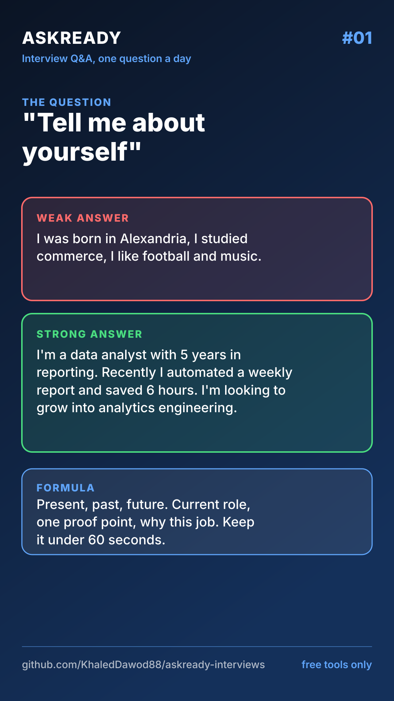
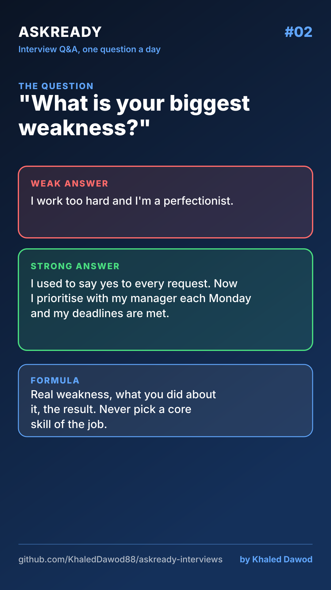

# Askready: Interview Q&A, one question a day

AskReady turns a JSON list of common interview questions (weak answer, strong answer and an answer formula) into 1080x1920 cards (SVG, PNG and an 8 second MP4).

Free tools only: Python standard library, optional headless Chrome for PNG, optional ffmpeg for video. No accounts, no API keys, nothing to pay for.

## Sample output

Cards are 1080x1920 (vertical short-video size). These two are rendered by this pipeline and committed as SVG so they show right here:





## How it works

1. `data/content.json` holds the content, one object per daily card (5 included).
2. `src/render.py` picks today's item (or the one you choose), draws the card as SVG, then optionally:
   - renders a PNG with headless Chrome (`--png`)
   - makes an 8 second MP4 with a slow zoom using ffmpeg (`--video`)
3. `.github/workflows/build.yml` runs the same command every day on GitHub Actions and uploads the files as a build artifact.

## Quick start

```bash
git clone https://github.com/KhaledDawod88/askready-interviews
cd askready-interviews
python src/render.py --all            # SVG cards for every item into out/
python src/render.py --png            # today's card as PNG too
python src/render.py --index 2 --video   # item 3 as PNG and MP4
```

## Add your own content

Append an object to `data/content.json` with the same keys as the existing items. The card layout is chosen by `src/render.py`; text wraps automatically, so keep lines short.

## Repo layout

- `src/render.py`: renderer and command line
- `data/content.json`: the content
- `samples/`: committed sample output
- `.github/workflows/build.yml`: daily automated build

## License

Code is free to use and adapt, with no warranty. Content belongs to the project owner.
